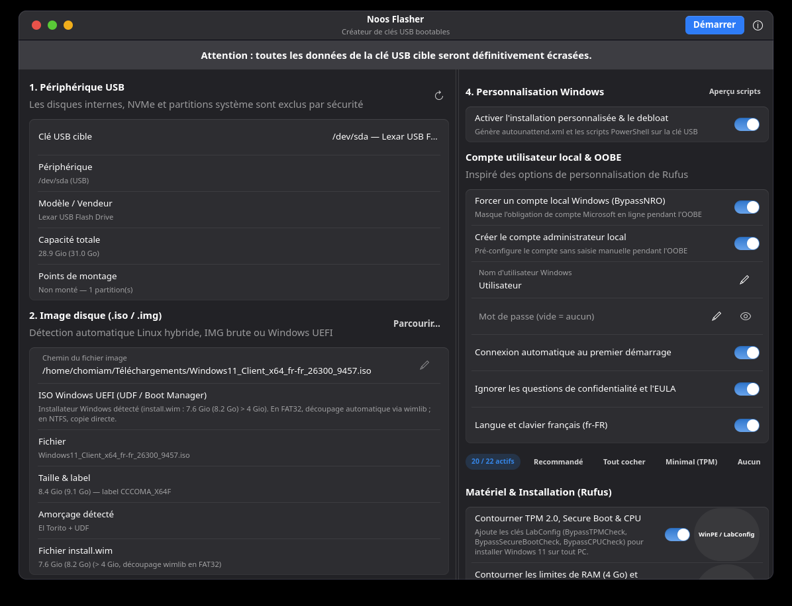

<p align="center">
  
</p>

<h1 align="center">Noos Flasher</h1>

<p align="center">
  <strong>La façon la plus simple de créer une clé USB bootable pour Linux ou Windows 10/11.</strong>
</p>

<p align="center">
  Une application native, rapide et sécurisée pour préparer vos clés USB sans ligne de commande.
</p>

<p align="center">
  <a href="https://github.com/Chomiam/noos-flasher/releases/latest">
    
  </a>
</p>

---

<p align="center">
  
</p>

## Une clé USB prête en quelques clics

Noos Flasher détecte automatiquement le type d'image que vous avez choisi, configure les paramètres adaptés et vous guide jusqu'à la création de la clé. Aucun terminal, aucune commande à retenir.

Que vous prépariez une installation Linux, une image disque ou un installateur Windows 11, l'interface reste claire, réactive et cohérente avec votre bureau GNOME.

## Pourquoi Noos Flasher ?

- **Interface native GTK4 / Libadwaita** — rapide, intégrée au bureau, sans WebView ni surcouche web.
- **Détection intelligente des images** — ISO Linux hybrides, images `.img` et installateurs Windows UEFI sont reconnus automatiquement.
- **Windows 11 simplifié** — contournement des vérifications TPM 2.0, Secure Boot, RAM et stockage, avec compte local préconfiguré.
- **Debloat Studio** — 22 optimisations sélectionnables pour alléger Windows avant même la première utilisation.
- **Sécurité par conception** — les disques internes et partitions système sont exclus, et l'écriture est déléguée à un service privilégié isolé via Polkit.
- **Progression lisible** — pourcentage, vitesse, octets traités et journal détaillé en temps réel.
- **NTFS pris en charge** — formatage NTFS et découpage automatique des gros `install.wim` pour FAT32.

## Fonctionnalités

### Création de clés USB Linux

- Écriture directe (mode DD) des ISO hybrides et images disque.
- Détection des signatures MBR, GPT, ISO 9660, El Torito et UDF.
- Écriture par blocs avec synchronisation matérielle et mesure du débit.
- Compatible avec les principales distributions Linux.

### Création de clés USB Windows 10/11 UEFI

- Partitionnement GPT ou MBR.
- Formatage FAT32 ou NTFS.
- Découpage automatique de `install.wim` en volumes `.swm` lorsque FAT32 est utilisé.
- Injection d'un fichier `autounattend.xml` pour automatiser l'installation.
- Compte administrateur local, connexion automatique, langue française et contournement de l'OOBE.
- **Debloat Studio** : suppression de Copilot, Recall, Bing, Cortana, Widgets, OneDrive et bloatwares, réduction de la télémétrie, menu contextuel classique et optimisations de performances.

### Sécurité et fiabilité

- Les disques internes, NVMe, partitions système et volumes critiques ne peuvent pas être sélectionnés.
- Double validation de la cible : côté interface et côté service privilégié.
- Élévation de privilèges via `pkexec` ; l'application graphique ne tourne jamais en root.
- Confirmation explicite avant toute opération destructive.
- Journal d'opérations copiable et messages d'erreur détaillés.

## Téléchargement

### Arch Linux

```bash
yay -S noos-flasher
```

### Debian, Ubuntu, Pop!_OS, Fedora, openSUSE et autres distributions

Choisissez le format adapté à votre système depuis la page des releases :

| Système | Format recommandé |
| --- | --- |
| Debian / Ubuntu / Pop!_OS / Mint | [Paquet `.deb`](https://github.com/Chomiam/noos-flasher/releases/latest) |
| Fedora / RHEL / openSUSE | [Paquet `.rpm`](https://github.com/Chomiam/noos-flasher/releases/latest) |
| Autres distributions Linux | [AppImage](https://github.com/Chomiam/noos-flasher/releases/latest) |

<p align="center">
  <a href="https://github.com/Chomiam/noos-flasher/releases/latest">
    <strong>Ouvrir la page des téléchargements →</strong>
  </a>
</p>

## Une expérience pensée pour le bureau

Noos Flasher utilise les composants natifs de GNOME : barre de titre Libadwaita, groupes de préférences, sélecteurs, notifications et dialogues de confirmation. Le résultat est une application légère, cohérente avec le système, qui reste fluide même pendant l'écriture d'une image de plusieurs gigaoctets.

Le volet de personnalisation Windows n'apparaît que lorsqu'une véritable ISO Windows est détectée : l'interface reste simple pour les images Linux et s'enrichit uniquement quand c'est utile.

## Contribuer

Les rapports de bugs, suggestions et contributions sont les bienvenus sur [GitHub](https://github.com/Chomiam/noos-flasher/issues).

## Licence

Noos Flasher est distribué sous licence **MIT**. Voir [LICENSE](LICENSE).
